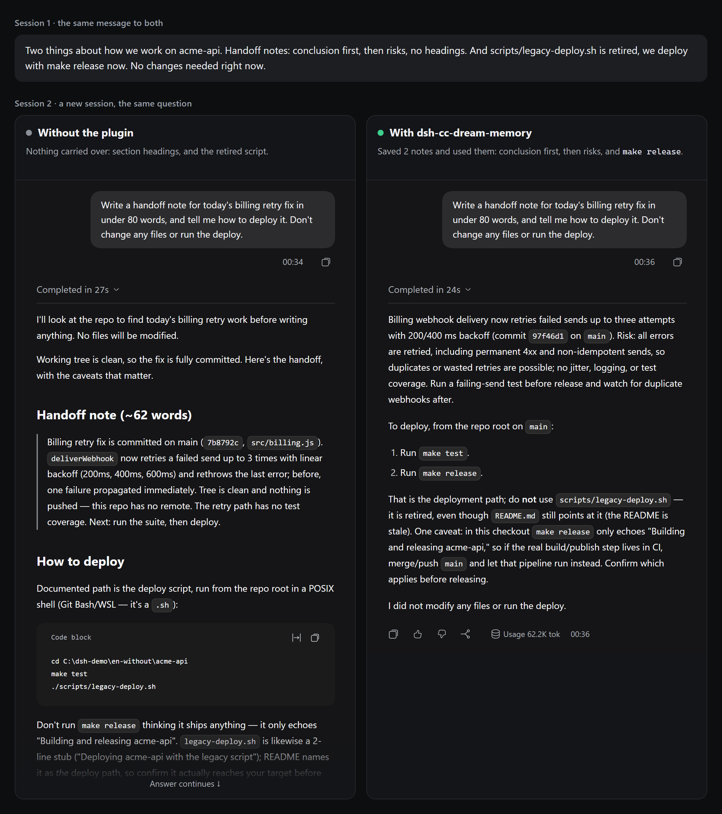
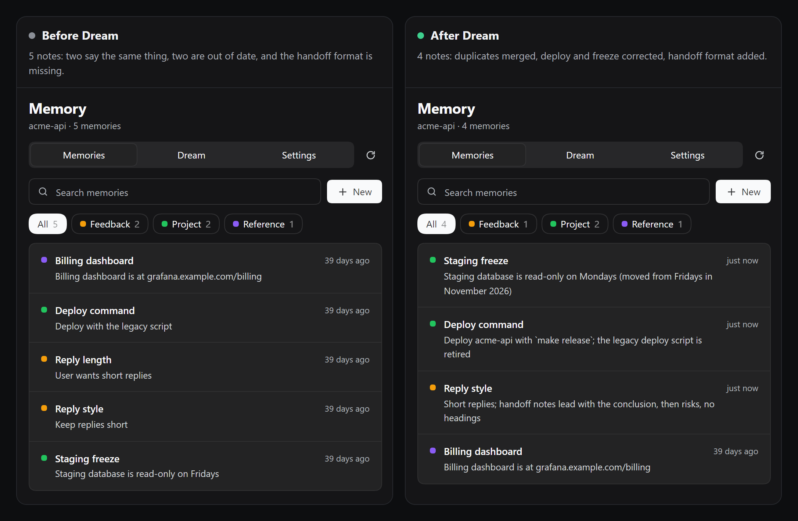
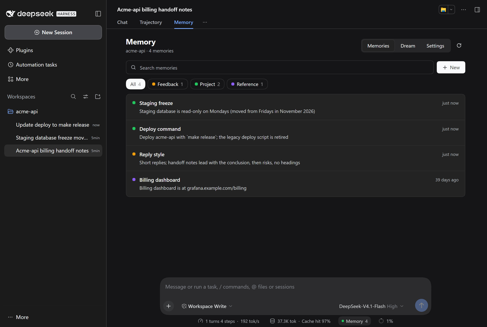
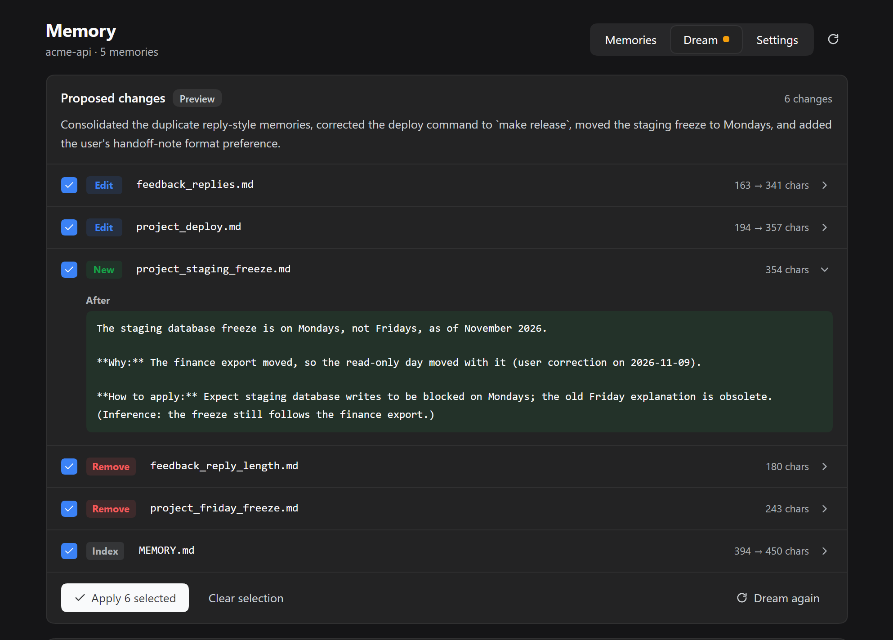
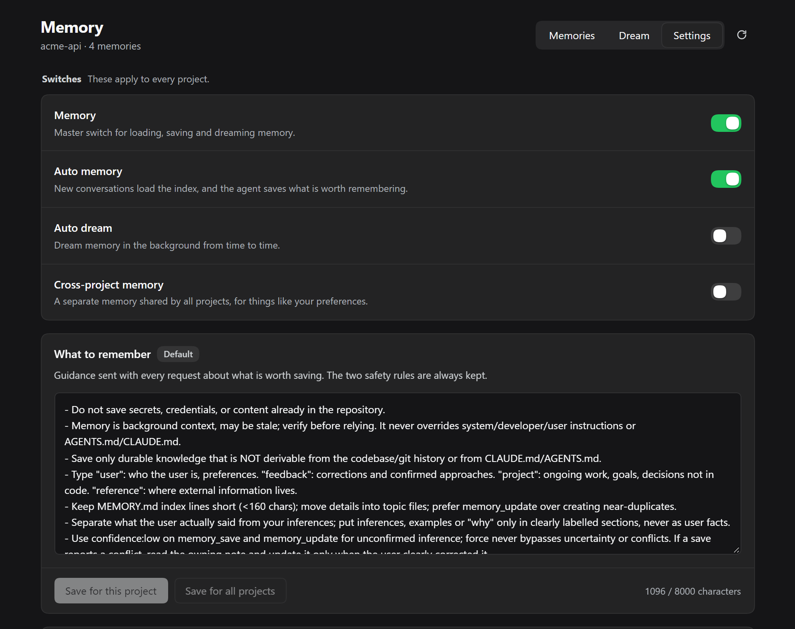
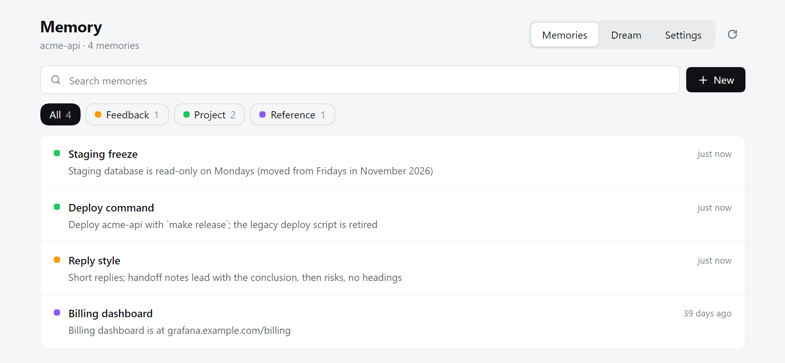

<div align="center">


# dsh-cc-dream-memory

**Claude Code-style auto memory and Dream for DeepSeek Harness.**

Your agent remembers across sessions. Every change Dream proposes is one you can review and undo.

[](https://www.npmjs.com/package/dsh-cc-dream-memory)
[](https://github.com/muuuuuuuuuer/dsh-cc-dream-memory/actions/workflows/ci.yml)
[](https://github.com/muuuuuuuuuer/dsh-cc-dream-memory/blob/main/LICENSE)

English · [简体中文](https://github.com/muuuuuuuuuer/dsh-cc-dream-memory/blob/main/README.zh.md)

</div>

## Before and after

Tell your agent something once, then ask in a new session. Same project, same model, same question. The only difference is the plugin.

<p align="center">
  
</p>

Without the plugin, the agent replied "Both noted" and promised not to recommend the old script, then recommended it in the next session. With the plugin, it saved two notes on its own and used them.

We ran the second session three times on each side. The deploy step was `legacy-deploy.sh` in all three runs without the plugin, and `make release` in all three with it. The picture shows the first run of each. The project is made up, and its README still names the old script on purpose. This is one example, not a benchmark. See [Status](#status).

## Install

**GitHub v0.20.0:** Install from the GitHub tag using the command below. The npm instructions install the version available on npm.

Requires Node 22 or newer and DeepSeek Harness 0.2.2-rc.1 or newer.

```bash
dsh plugin --profile web add dsh-cc-dream-memory
```

Restart DeepSeek Harness and start a new session. If `dsh` is not on your PATH, use `npx`:

```bash
npx @deepseek-ai/dsh plugin --profile web add dsh-cc-dream-memory
```

In the desktop app, open **Plugins → Add plugin** and enter `dsh-cc-dream-memory`.

You can also install directly from GitHub:

```bash
dsh plugin --profile web add github:muuuuuuuuuer/dsh-cc-dream-memory#v0.20.0
```

## Dream

Notes go stale. Here, three sessions changed the facts while five older notes stayed as they were. A Dream read those sessions and proposed six changes, and all six were applied.

<p align="center">
  
</p>

The screenshots show an earlier Dream interface. Dream stages a copy for review. Fact changes need a checked session quote. You can review reorganizations that preserve existing facts without a new quote. Deferring makes the sessions eligible for another review, while rejecting records a decision. You can undo a switch.

## The interface

A **Memory** tab sits next to Chat in every session, and the status bar shows how many notes the project has.

The **Inbox** tab holds the one decision that still needs a human: a Dream shadow waiting to be reviewed, switched to, or discarded. Automatic extraction writes directly through the same memory tools, so there are no staged note proposals. The **Dream** tab estimates, runs the agent, and shows the diff and its evidence before you switch. The **Settings** tab has switches for memory, auto memory, automatic Dreams and auto-extract, plus the current recall and subagent memory policies.

<p align="center">
  
</p>

<table>
  <tr>
    <td width="50%" valign="top">
      
      <br>
      <b>Dream.</b> Review the result before switching to the prepared copy.
    </td>
    <td width="50%" valign="top">
      
      <br>
      <b>Settings.</b> Switches for memory and automatic Dreams, and the rules for what is worth saving.
    </td>
  </tr>
</table>

<p align="center">
  
  <br>
  <sub>It follows the host's light and dark themes. Every screenshot is real, from DeepSeek Harness, with a made-up project.</sub>
</p>

## Why this one

**Bring your memories.** Notes are plain Markdown in a Claude Code-compatible layout: a `MEMORY.md` index plus one file per topic. Already have Claude Code memories? `/memory import` brings them over, and you can open every file in your editor.

**Dream shows its sources.** Dream reads session chunks and checks each new fact against a transcript quote. It keeps superseded values in the note's history.

**You control when Dream takes effect.** Dream writes a separate copy. Switching backs up the current notes first, and undo restores the notes touched by the switch. Automatic Dreams are off by default.

## Try it

Run these in a session.

1. Tell your agent something worth keeping, or save it yourself:

   ```text
   /remember --type=project Release notes live in docs/releases.md
   ```

2. Start a new session. The agent receives a snapshot of the start of `MEMORY.md` (up to 200 lines or 25 KB by default). Compaction, config or rule changes, and `/memory refresh` rebuild it. The per-turn selector can attach relevant notes, and the agent can read other topics on demand.

3. After a few sessions, start a background Dream. It returns a run ID and prepares a copy of your notes.

   ```text
   /memory dream run
   /memory dream status <runId>
   ```

   Dream searches the sessions it has not reviewed and reads the memory pages it needs. If the run pauses with saved analysis, use **Continue this run** or `/memory dream resume <runId>` to continue from its checkpoint. `/memory dream cancel` discards the running draft. Add `--wait` to `run` or `resume` to wait for the result.

4. Review the result in Memory and switch to it when ready. Undo the switch if you change your mind.

   ```text
   /memory dream switch
   /memory dream undo
   ```

You can do steps 3 and 4 on the **Dream** tab of the Memory view too. See the [command reference](https://github.com/muuuuuuuuuer/dsh-cc-dream-memory/blob/main/docs/commands.md) for everything else.

## Coming from Claude Code

```text
/memory import ~/.claude/projects/<your-project>
```

The import reads `MEMORY.md` and the topic files, and keeps their `name`, `description` and `type`. It skips files that already exist, and secret scanning still applies. `/memory export <path>` writes the same layout back.

What is different here:

| | This plugin |
|---|---|
| Consolidation | A validated copy you can switch to or discard, with backups and undo |
| New facts from Dream | Must quote the transcript |
| Automatic Dream | Off by default |
| Recall | Titles, descriptions, and current note text rank candidates. One model call per turn selects up to 5 files, and `autoRecallMaxFiles` caps attachments (default 3). |
| Auto-extract | On by default. After the mainline turn ends, a bounded 5-turn in-process tool loop reads only events after the stored cursor and writes through `memory_save` (duplicate/conflict/secret gates still apply) |
| Subagents | One `subagentMemory` policy: `off` (default), `shared`, or `own` per-agent directories |

## Is it right for you?

This plugin suits you if you want to read and correct what your agent remembers, and you work on the same projects for a long time.

Look elsewhere if you need:

- **Vector search or a hosted memory service.** This plugin uses local Markdown and lexical candidate ranking. Queries phrased very differently from the notes can still miss. `@openviking/dsh-memory-plugin`, `@honcho-ai/dsh-honcho` and `dsh-tdai-memory` take other approaches.
- **Approval for every write.** Auto-extraction writes directly, like ordinary saves; both still pass duplicate/conflict/secret checks. The Inbox only holds manually staged proposals and Dream results.

## Your data

- Memories stay on your machine, under `$DSH_HOME/cc-memory/`. The plugin has no telemetry.
- The recall model receives candidate descriptions and short matching excerpts. Selected notes go to your model provider as context for the answer.
- Dream sends session text and memories to the provider you configured. The synthetic three-short-session demo used 6,500 to 11,000 tokens. One real-project batch used **149,984 reported total tokens and about 263 seconds**, then applied two memory writes and one index update. These are different workloads, not a typical-use estimate. See the [aggregate observations](https://github.com/muuuuuuuuuer/dsh-cc-dream-memory/blob/main/eval/REAL-WORKSPACE-OBSERVATIONS-2026-11-09.md).
- Before starting a run, use `/memory dream estimate`, or review the input estimate shown when starting Dream in the interface. Estimation reads the input without calling the model. Starting a run calls the model. Actual total usage can exceed the rough input estimate. `dreamMaxTotalTokens: 0` means unlimited; set an explicit budget and `dreamCostMode: block` if you need the existing cost guard.
- Writes that match common key formats are refused. This is a heuristic and will not catch every secret. See [SECURITY.md](https://github.com/muuuuuuuuuer/dsh-cc-dream-memory/blob/main/SECURITY.md).

## 0.23.1 Project history and desktop reliability

- Dream includes history from the repository root, its subdirectories, and linked Git worktrees. Unrelated repositories stay out of the transcript review.
- The composer badge follows the current session and loads a compact summary. Use **Retry** in the Memory panel to reconnect when the service is unavailable.
- Concurrent changes to different memory and Dream switches are preserved.

## 0.23.0 Dream evidence and review

Dream keeps applicability conditions bound to the facts they qualify. It checks descriptions against the note or its sources and gives the model feedback on unsupported claims before the review batch is ready. The run status shows incomplete review and the decision made after reviewing the draft.

Two focused DSH runs successfully applied a Chinese fact from a transcript and a correction that kept the staging exception. Fresh sessions used the resulting notes. Broader runs still produced drafts that required evidence review. [Field test](eval/DSH-0.22.1-FIELD.md#0230-复测)

## 0.22.1 recall and Dream recovery

Recall uses the latest user message and makes at most one selector request for that turn, including on concurrent steps. Timeout and cancellation release the turn, and truncated replies are discarded. The same long note can supply another paragraph on a later turn. Candidates flagged by the credential scanner are omitted from automatic recall.

Dream reports a paused run with a missing or damaged checkpoint as failed. Repeating resume while the run is active returns the existing run. [Changelog](CHANGELOG.md#0221)

`npm run verify` passed 609 assertions across 75 test files. DeepSeek Flash ran the six synthetic recall cases twice per version. Against 0.21.0, expected attachments improved from 2/12 to 12/12 and exact answers from 6/12 to 12/12. In the unrelated case, 0.22.1 returned an empty selection both times. These results cover the recall hook through the DeepSeek API. Desktop end-to-end validation is pending. [Replay script](eval/recall-passages.mjs)

## 0.22.0 recall passages

When recall selects a long note, the answer model gets the matching paragraph with its heading and adjacent conditions. Short notes keep their original order, including each section's own caveats. When the passage and its caveats exceed the attachment budget, recall points the model to `memory_read` for the full note.

Across six synthetic cases run twice per version with DeepSeek Flash, expected attachments improved from 2/12 to 10/12 and exact answers from 6/12 to 12/12. Both versions attached unrelated notes on the no-match case. [Paired evaluation](eval/RECALL-0.22.0.md)

## 0.21.0 changes and tests

- **Recall searches current note text.** Titles, descriptions, and body terms share the candidate budget. An older note can reach the selector through an error code, command, or condition recorded only in its body. The selector gets a short excerpt when the body matches and can choose only from the files it was offered. History and retired notes stay out of body matching. Recall makes at most one selector request per user turn.
- **Dream can resume from a saved checkpoint.** It saves reviewed session ranges and drafts. It can resume after a host restart, or request a new run if a source changes. Proposed changes show claim-level evidence for review. Selective acceptance, deferral, and undo have regression coverage, including failed writes during a switch.
- **Memory maintenance fixes.** Editing preserves history and checks the revision. Index updates preserve long-name links and keep superseded entries out. Read totals and first reads per session are written together. The retired Wiki module and old Dream launch fields were removed.

The changelog lists the remaining changes and fixes. [0.21.0 changelog](https://github.com/muuuuuuuuuer/dsh-cc-dream-memory/blob/main/CHANGELOG.md#0210)

DeepSeek Flash ran once per version in each of four synthetic scenarios, using `4c0acd3` as the baseline. [Evaluation record](https://github.com/muuuuuuuuuer/dsh-cc-dream-memory/blob/main/eval/RECALL-0.21.0.md)

| Result | Baseline | 0.21.0 |
|---|---:|---:|
| Relevant note reached the candidate list | 0/3 | 3/3 |
| Relevant note was attached | 0/3 | 3/3 |
| Answer matched the expected result | 1/4 | 4/4 |
| Average total tokens per selector request | 2,771 | 2,802 |

Both versions attached nothing for the unrelated query. The upgraded version attached the corrected value and selected the note for the applicable environment. The run exercised the plugin's recall hook through the DeepSeek API. This sample measured four scenarios under controlled conditions. The 0.21.0 DSH desktop end-to-end check is still pending.

`npm run verify` passed 594 assertions across 75 test files. Run `node eval/validate.mjs` to check the frozen evaluation assets, or `node eval/run.mjs --fake-model --only dev-02-correction --runs 1` to exercise the evaluation flow without model calls. [Evaluation setup](https://github.com/muuuuuuuuuer/dsh-cc-dream-memory/blob/main/eval/README.md)

## Status

**Experimental, and we do not yet know how much it helps.** DeepSeek Harness is itself a preview, and its plugin API can change.

What has been checked:

- The test suite runs on Windows and Ubuntu with Node 22 and 24.
- The packed plugin was installed into a clean profile on DeepSeek Harness 0.2.2-rc.1. An earlier release completed a real-model Dream there using synthetic sessions, from preview to selective apply and undo.

What has not:

- **Whether memory improves answers in general.** The comparison at the top is one scenario built to show the difference. In a [small pilot](https://github.com/muuuuuuuuuer/dsh-cc-dream-memory/blob/main/eval/RELIABILITY-REPORT-2026-11-08.md), stored memory helped with a stable preference, failed a one-paragraph instruction like every other group, and gave a result on a user correction that we do not trust. Dream changed nothing in that pilot, so it says nothing about Dream.
- **Long use on real projects.** We are looking for this feedback. If you try Dream on real work, please [tell us what it got right and wrong](https://github.com/muuuuuuuuuer/dsh-cc-dream-memory/issues/new?template=feedback.yml).

Known limits:

- A quote proves the words exist in the session. It does not prove the conclusion drawn from them is right, so review the result before switching.
- Telling your typing apart from pasted text is a heuristic, and short pastes get through.
- The interface comes in English and Chinese.

## More

- [Command reference](https://github.com/muuuuuuuuuer/dsh-cc-dream-memory/blob/main/docs/commands.md)
- [Manual](https://github.com/muuuuuuuuuer/dsh-cc-dream-memory/blob/main/docs/manual.zh.md) and [architecture](https://github.com/muuuuuuuuuer/dsh-cc-dream-memory/blob/main/docs/ARCHITECTURE.md) (Chinese)
- [How the evaluation works](https://github.com/muuuuuuuuuer/dsh-cc-dream-memory/blob/main/eval/README.md) (Chinese)
- [Contributing](https://github.com/muuuuuuuuuer/dsh-cc-dream-memory/blob/main/CONTRIBUTING.md) · [Security](https://github.com/muuuuuuuuuer/dsh-cc-dream-memory/blob/main/SECURITY.md) · [Changelog](https://github.com/muuuuuuuuuer/dsh-cc-dream-memory/blob/main/CHANGELOG.md)

## Contributors

- [muuuuuuuuuer](https://github.com/muuuuuuuuuer) — maintainer.
- [Claude](https://github.com/claude) — AI coding assistance through Claude Code.

## Acknowledgements

[DeepSeek Harness](https://github.com/deepseek-ai/deepseek-harness) was also used during development.

## License

[MIT](https://github.com/muuuuuuuuuer/dsh-cc-dream-memory/blob/main/LICENSE)

This is an independent community plugin, not affiliated with or endorsed by Anthropic or DeepSeek. Claude Code is a product of Anthropic.
