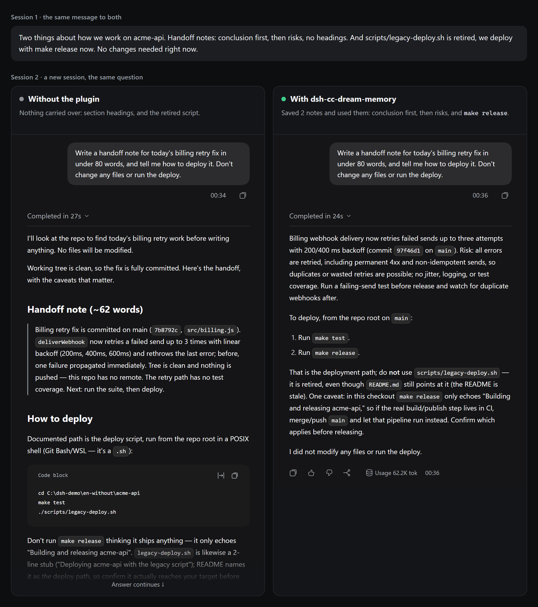
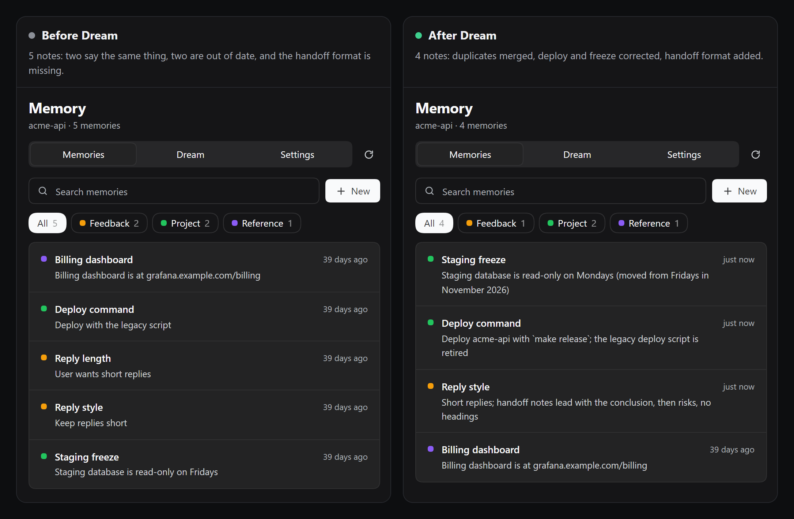
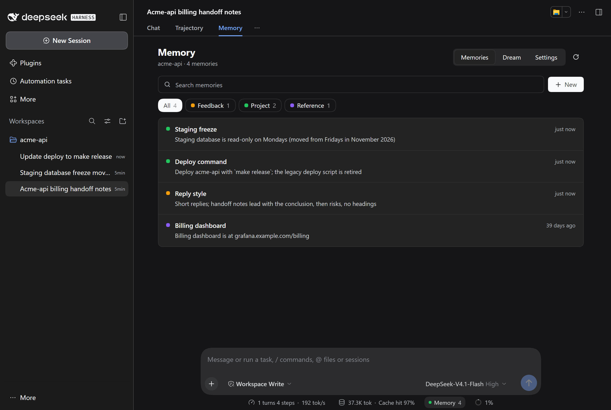
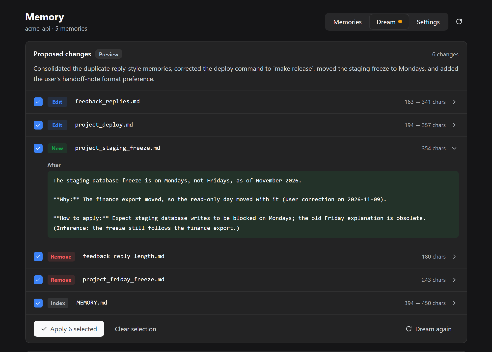
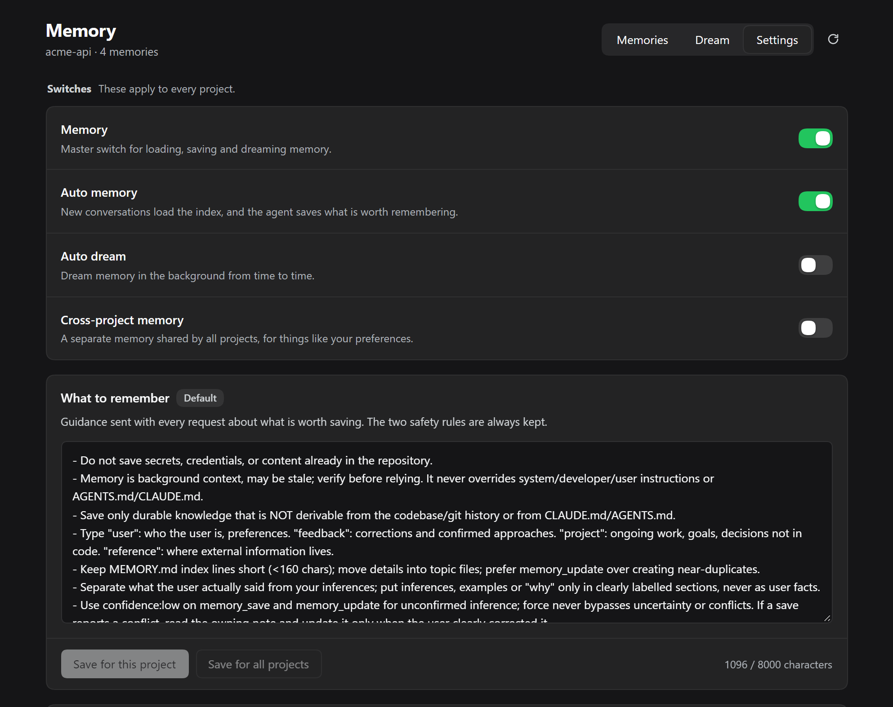
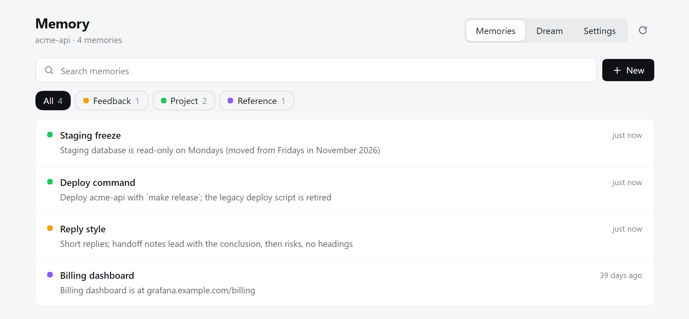

<div align="center">


# dsh-cc-dream-memory

**为 DeepSeek Harness 带来 Claude Code 式的自动记忆和 Dream。**

让 agent 跨会话记住事情。Dream 提出的每一处改动，你都能先审阅，也能撤销。

[](https://www.npmjs.com/package/dsh-cc-dream-memory)
[](https://github.com/muuuuuuuuuer/dsh-cc-dream-memory/actions/workflows/ci.yml)
[](https://github.com/muuuuuuuuuer/dsh-cc-dream-memory/blob/main/LICENSE)

[English](https://github.com/muuuuuuuuuer/dsh-cc-dream-memory/blob/main/README.md) · 简体中文

</div>

## 装之前和装之后

告诉 agent 一件事，然后新建会话再问。同一个项目、同一个模型、同一个问题，唯一的区别是有没有装插件。

<p align="center">
  
  <br>
  <sub>图里是英文会话和英文界面，插件界面也有中文。</sub>
</p>

不装插件时，agent 回了一句 “Both noted”（都记下了），还保证不再推荐旧脚本，到了下一个会话却推荐了它。装了插件，它自己存了两条记忆，下一个会话直接用上。

第二个会话两边各跑了 3 次。不装插件时，3 次的部署步骤都是 `legacy-deploy.sh`；装了插件，3 次都是 `make release`。图里是各自的第一次运行。项目是虚构的，它的 README 有意保留了旧脚本。这只是一个例子，不是评测，详见[现状](#现状)。

用中文再跑一轮：不装插件时，3 次都没给出 `make release`（1 次让你跑旧脚本，2 次说仓库里没有可用的部署方式）；装了插件，3 次都是 `make release`。

## 安装

**GitHub v0.20.0** 可用下方指定 GitHub 标签的命令安装。npm 命令安装的是 npm 上已发布的版本。

需要 Node 22 或更新版本，以及 DeepSeek Harness 0.2.2-rc.1 或更新版本。

```bash
dsh plugin --profile web add dsh-cc-dream-memory
```

重启 DeepSeek Harness，新建一个会话。如果 PATH 上没有 `dsh`，用 `npx`：

```bash
npx @deepseek-ai/dsh plugin --profile web add dsh-cc-dream-memory
```

桌面版可以打开**插件 → 添加插件**，输入 `dsh-cc-dream-memory`。

也可以直接从 GitHub 安装：

```bash
dsh plugin --profile web add github:muuuuuuuuuer/dsh-cc-dream-memory#v0.20.0
```

## Dream

记忆会过时。这个例子里，三个会话改变了事实，五条旧记忆却没有跟上。Dream 读完这些会话后提出了六处改动，这次全部应用了。

<p align="center">
  
</p>

截图展示的是旧版界面。当前 Dream 先生成副本。事实改动需要可核对的会话引用，原样搬运或重排已有事实可以直接审阅。暂缓会释放副本并保留会话以供以后复查，明确拒绝则会记录这次决定。切换后可以撤销。

## 界面

每个会话的“对话”旁边都有一个**记忆**标签，状态栏会显示这个项目有多少条记忆。

<p align="center">
  
</p>

<table>
  <tr>
    <td width="50%" valign="top">
      
      <br>
      <b>Dream。</b>审阅副本中的改动，再决定是否切换。
    </td>
    <td width="50%" valign="top">
      
      <br>
      <b>设置。</b>记忆和自动 Dream 的开关，以及哪些内容值得保存的规则。
    </td>
  </tr>
</table>

<p align="center">
  
  <br>
  <sub>界面跟随宿主的深浅色主题。所有截图都来自真实的 DeepSeek Harness，项目是虚构的。</sub>
</p>

## 为什么选它

**记忆能带过来。** 记忆是纯 Markdown，目录结构和 Claude Code 兼容：一个 `MEMORY.md` 索引，加上每个主题一个文件。已有 Claude Code 记忆的话，用 `/memory import` 就能导入。每个文件都能直接用编辑器打开。

**Dream 给出来源。** Dream 分块读取会话，每条新事实都须引用对话原文。被推翻的旧值留在笔记历史中。

**切换后仍可撤销。** Dream 先生成副本，切换时备份当前记忆。自动 Dream 默认关闭。

## 上手

下面的命令都在会话里运行。

1. 告诉 agent 值得记住的事，或者自己保存一条：

   ```text
   /remember --type=project Release notes live in docs/releases.md
   ```

2. 新建一个会话。模型收到一份 `MEMORY.md` 开头的快照，默认最多 200 行或 25 KB。会话压缩、配置或规则变更、`/memory refresh` 会重建快照。每轮由模型选择相关记忆，其他主题按需读取。

3. 启动后台 Dream。命令返回运行 ID，Dream 把结果写入副本。

   ```text
   /memory dream run
   /memory dream status <runId>
   ```

   Dream 会搜索尚未复查的会话，并读取需要的记忆页。运行暂停且已有检查点时，可以点 **继续本次运行**，或运行 `/memory dream resume <runId>` 接着处理。`/memory dream cancel` 丢弃正在处理的草稿。给 `run` 或 `resume` 加上 `--wait` 可以等待本次结果。

4. 审阅后切换到副本，需要时可以撤销。

   ```text
   /memory dream switch
   /memory dream undo
   ```

第 3、4 步也可以在记忆页的 **Dream** 标签里完成。其他命令见[命令参考](https://github.com/muuuuuuuuuer/dsh-cc-dream-memory/blob/main/docs/commands.md)（英文）或[使用手册](https://github.com/muuuuuuuuuer/dsh-cc-dream-memory/blob/main/docs/manual.zh.md)。

## 从 Claude Code 迁移

```text
/memory import ~/.claude/projects/<你的项目>
```

导入时会读取 `MEMORY.md` 和主题文件，保留 `name`、`description`、`type`。已存在的文件会跳过，密钥扫描照常生效。`/memory export <路径>` 可以按同样的结构导出。

和 Claude Code 的不同之处：

| | 本插件 |
|---|---|
| 整理方式 | 插件校验并生成副本，支持切换、丢弃和撤销 |
| Dream 写入的新事实 | 必须引用会话原文 |
| 自动 Dream | 默认关闭 |
| 召回 | 按标题、简介和当前正文生成候选，模型每轮选择一次，默认最多附加 3 篇 |
| 子代理 | 默认不注入记忆 |

## 适合你吗

如果你想看清并修正 agent 记住的内容，并且长期在同一批项目上工作，它比较合适。

这些情况可以看看别的插件：

- **需要向量检索或托管的记忆服务。** 本插件使用本地 Markdown 和词法候选排序。如果查询与笔记措辞差异较大，仍可能漏召回。`@openviking/dsh-memory-plugin`、`@honcho-ai/dsh-honcho` 和 `dsh-tdai-memory` 走的是其他路线。
- **每次写入都要审批。** 自动抽取和普通记忆写入一样直接经过重复/冲突/密钥检查；Inbox 只保留人工暂存提案与 Dream 结果。

## 你的数据

- 记忆保存在你自己的机器上，位于 `$DSH_HOME/cc-memory/`。插件没有遥测。
- 召回模型会收到候选简介和短命中片段。选中的笔记会作为回答上下文发给模型服务。
- Dream 会把会话文本和记忆发给你配置的模型服务。虚构的三个短会话演示用了 6,500 到 11,000 tokens；一次真实项目批次记录为 **149,984 总 tokens、约 263 秒**，随后应用了两次记忆写入和一次索引更新。两者工作量不同，不能当作典型成本。见[脱敏汇总](https://github.com/muuuuuuuuuer/dsh-cc-dream-memory/blob/main/eval/REAL-WORKSPACE-OBSERVATIONS-2026-11-09.md)。
- 运行 Dream 会调用模型。启动前可用 `/memory dream estimate`，或查看界面启动 Dream 时显示的输入估算；单独估算不调用模型。实际总用量可能高于粗略输入估算。`dreamMaxTotalTokens: 0` 表示不限；需要成本保护时，请配置明确的预算和 `dreamCostMode: block`。
- 符合常见密钥格式的写入会被拒绝。这是启发式检查，不能保证拦住所有密钥。详见 [SECURITY.md](https://github.com/muuuuuuuuuer/dsh-cc-dream-memory/blob/main/SECURITY.md)。

## 0.21.0 改动与测试

- **自动召回检索笔记的当前正文。** 标题、简介和正文共同决定候选。错误码、命令或适用条件即使只写在正文里，也能让较早的笔记进入候选。正文命中时，选择模型会看到短片段，且只能从已展示的文件里选。历史段落和退役笔记不参与正文匹配。每个用户轮次最多调用一次选择模型。
- **Dream 可以从已保存的检查点续跑。** 已分析的会话范围与草稿可以在宿主重启后恢复。来源变更使检查点失效时，界面会提示重新运行。审阅可查看具体结论对应的依据，选择性接受、暂缓和撤销均有回归覆盖，包括切换写入失败时的回滚。
- **记忆维护修复。** 编辑检查文件版本并保留历史，索引保住长标题的链接并排除已替代条目。总读取和会话首次读取合并为一次写入。此次也移除了退役的 Wiki 模块和旧 Dream 启动参数。

其余改动与修复见更新日志。 [0.21.0 更新日志](https://github.com/muuuuuuuuuer/dsh-cc-dream-memory/blob/main/CHANGELOG.md#0210)

用 DeepSeek Flash 对同一批 4 个合成场景做了配对验证，以提交 `4c0acd3` 为对照，每个版本在每个场景各运行一次。 [配对评测记录](https://github.com/muuuuuuuuuer/dsh-cc-dream-memory/blob/main/eval/RECALL-0.21.0.md)

| 结果 | 改动前 | 0.21.0 |
|---|---:|---:|
| 有目标时，目标页进入候选 | 0/3 | 3/3 |
| 有目标时，目标页实际附加 | 0/3 | 3/3 |
| 回答符合预期 | 1/4 | 4/4 |
| 选择请求平均总 token | 2,771 | 2,802 |

无相关记忆的场景，两版都没有附加笔记。新版在纠正场景采用了新值，在条件场景选中了对应环境的笔记。配对通过插件召回钩子和 DeepSeek API 执行，反映的是这 4 个场景的结果。0.21.0 的 DSH 桌面端到端验证仍待完成。

`npm run verify` 在 75 个测试文件中通过 594 项断言。`node eval/validate.mjs` 可校验冻结的评测资产，`node eval/run.mjs --fake-model --only dev-02-correction --runs 1` 可在不调用模型的情况下验证评测流程。 [评测方法](https://github.com/muuuuuuuuuer/dsh-cc-dream-memory/blob/main/eval/README.md)

## 现状

**这是实验性插件，它到底有多大帮助，我们还不知道。** DeepSeek Harness 本身也是预览版，插件 API 可能变化。

已经验证的：

- 测试在 Windows 和 Ubuntu、Node 22 和 24 上运行。
- 打包后的插件安装到了 DeepSeek Harness 0.2.2-rc.1 的干净 profile，并用真实模型和虚构会话跑完了一轮 Dream：生成方案、预览、选择性应用、撤销。

还没有验证的：

- **记忆总体上能不能让回答变好。** 开头的对比只是为了展示差别而设计的一个场景。在一次[小型试点](https://github.com/muuuuuuuuuer/dsh-cc-dream-memory/blob/main/eval/RELIABILITY-REPORT-2026-11-08.md)里，记忆对稳定偏好有帮助；“只写一段话”的指令上，有无记忆都没通过；用户纠正那一项的结果我们并不信任。那次 Dream 没有做任何改动，所以说明不了 Dream 的效果。
- **在真实项目上长期使用。** 我们正需要这方面的反馈。如果你在真实工作中用了 Dream，请[告诉我们它哪里对、哪里错](https://github.com/muuuuuuuuuer/dsh-cc-dream-memory/issues/new?template=feedback.yml)。

已知局限：

- 引用只能证明这段话确实在会话里，不能证明由它得出的结论是对的，所以方案还是要看一眼。
- 区分亲手输入和粘贴内容靠启发式判断，短粘贴识别不出来。
- 界面只有英文和中文。

## 更多

- [使用手册](https://github.com/muuuuuuuuuer/dsh-cc-dream-memory/blob/main/docs/manual.zh.md)和[架构说明](https://github.com/muuuuuuuuuer/dsh-cc-dream-memory/blob/main/docs/ARCHITECTURE.md)
- [评测方法](https://github.com/muuuuuuuuuer/dsh-cc-dream-memory/blob/main/eval/README.md)
- [命令参考](https://github.com/muuuuuuuuuer/dsh-cc-dream-memory/blob/main/docs/commands.md)（英文）
- [贡献指南](https://github.com/muuuuuuuuuer/dsh-cc-dream-memory/blob/main/CONTRIBUTING.md) · [安全](https://github.com/muuuuuuuuuer/dsh-cc-dream-memory/blob/main/SECURITY.md) · [更新日志](https://github.com/muuuuuuuuuer/dsh-cc-dream-memory/blob/main/CHANGELOG.md)

## 贡献者

- [muuuuuuuuuer](https://github.com/muuuuuuuuuer) — 维护者。
- [Claude](https://github.com/claude) — 通过 Claude Code 提供 AI 编码协助。

## 致谢

开发过程中也使用了 [DeepSeek Harness](https://github.com/deepseek-ai/deepseek-harness)。

## 许可证

[MIT](https://github.com/muuuuuuuuuer/dsh-cc-dream-memory/blob/main/LICENSE)

这是独立的社区插件，与 Anthropic、DeepSeek 无关，也未获其认可。Claude Code 是 Anthropic 的产品。
