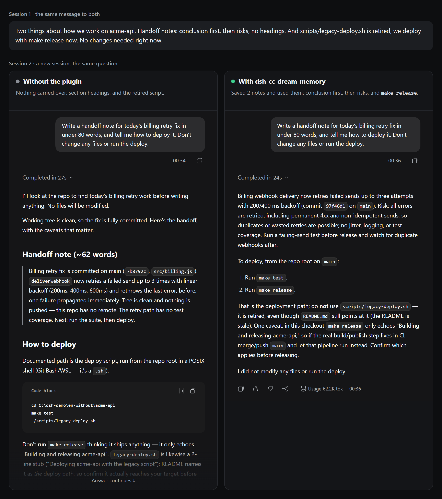
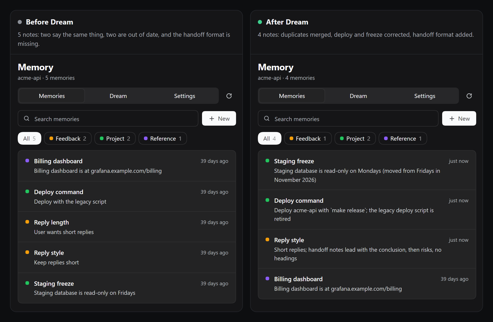
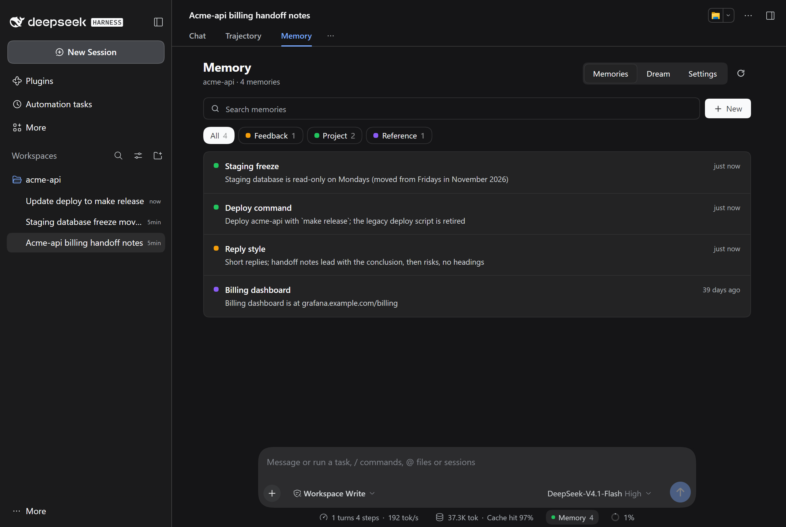
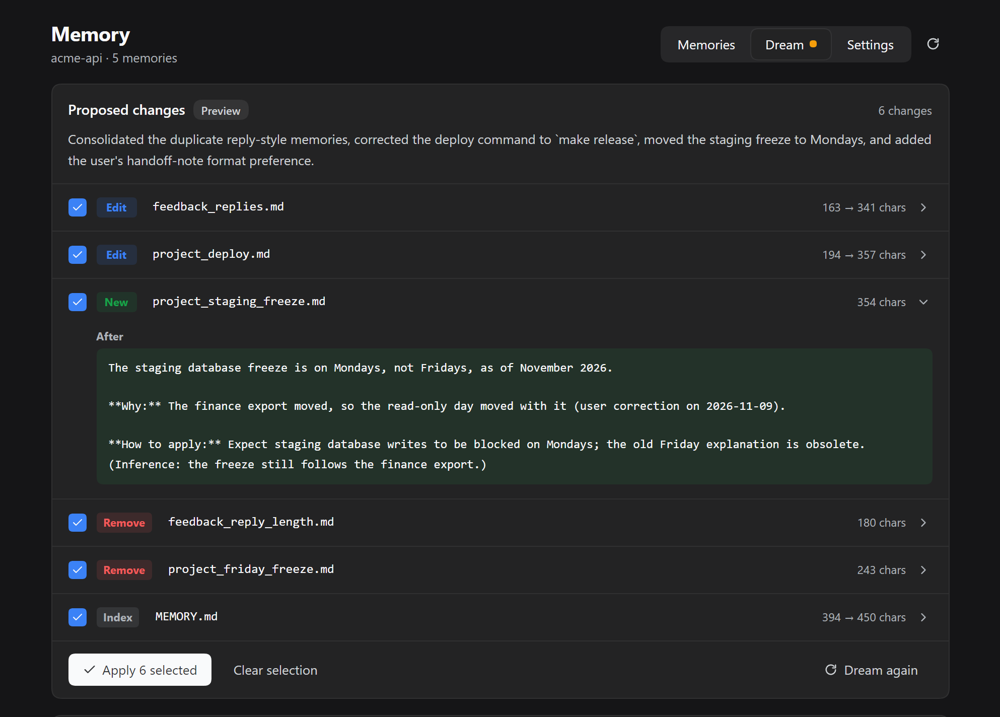
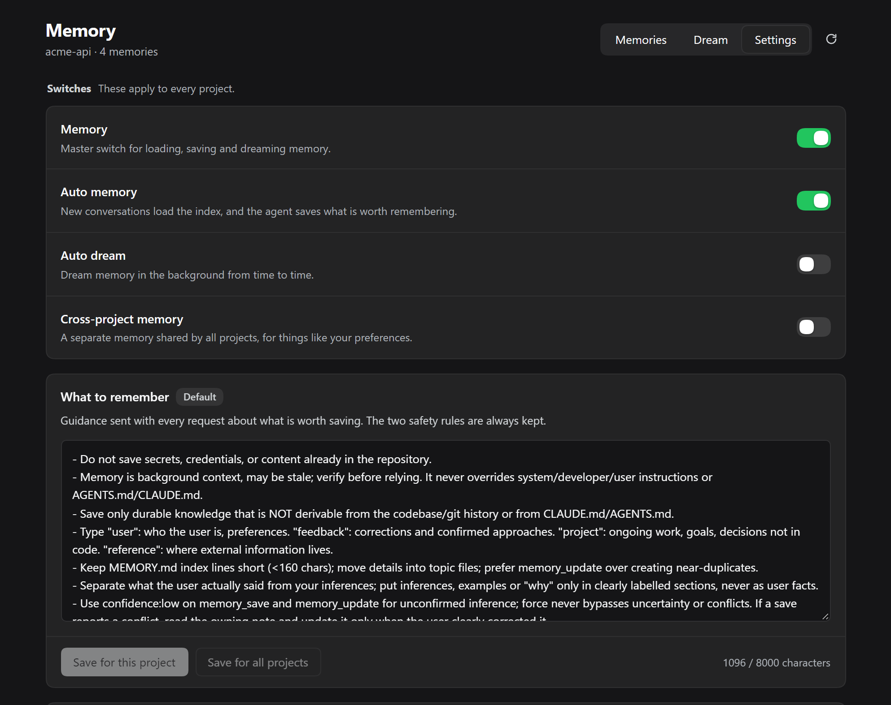
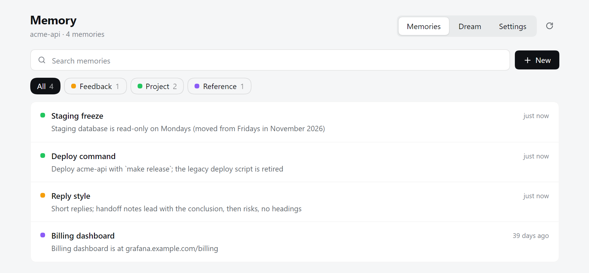

<div align="center">


# dsh-cc-dream-memory

**为 DeepSeek Harness 带来 Claude Code 式的自动记忆和 Dream。**

让 agent 跨会话记住事情。Dream 提出的每一处改动，你都能先审阅，也能撤销。

[](https://www.npmjs.com/package/dsh-cc-dream-memory)
[](https://github.com/muuuuuuuuuer/dsh-cc-dream-memory/actions/workflows/ci.yml)
[](LICENSE)

[English](README.md) · 简体中文

</div>

## 装之前和装之后

告诉 agent 一件事，然后新建会话再问。同一个项目、同一个模型、同一个问题，唯一的区别是有没有装插件。

<p align="center">
  
  <br>
  <sub>图里是英文会话和英文界面，插件界面也有中文。</sub>
</p>

不装插件时，agent 回了一句 “Both noted”（都记下了），还保证不再推荐旧脚本，到了下一个会话却推荐了它。装了插件，它自己存了两条记忆，下一个会话直接用上。

第二个会话两边各跑了 3 次。不装插件时，3 次的部署步骤都是 `legacy-deploy.sh`；装了插件，3 次都是 `make release`。图里是各自的第一次运行。项目是虚构的，它的 README 有意保留了旧脚本。这只是一个例子，不是评测，详见[现状](#现状)。

用中文再跑一轮：不装插件时，3 次都没给出 `make release`（1 次让你跑旧脚本，2 次说仓库里没有可用的部署方式）；装了插件，3 次都是 `make release`。

## 安装

```bash
dsh plugin --profile web add dsh-cc-dream-memory
```

重启 DeepSeek Harness，新建一个会话。如果 PATH 上没有 `dsh`，用 `npx`：

```bash
npx @deepseek-ai/dsh plugin --profile web add dsh-cc-dream-memory
```

桌面版可以打开**插件**页，搜索 `dsh-cc-dream-memory`。

## Dream

记忆会过时。这个例子里，三个会话改变了事实，五条旧记忆却没有跟上。Dream 读完这些会话后提出了六处改动，这次全部应用了。

<p align="center">
  
</p>

你可以只应用其中一部分，一条命令就能撤销整次 Dream。

## 界面

每个会话的“对话”旁边都有一个**记忆**标签，状态栏会显示这个项目有多少条记忆。

<p align="center">
  
</p>

<table>
  <tr>
    <td width="50%" valign="top">
      
      <br>
      <b>Dream。</b>点开任何一处改动查看内容，只应用你认可的。
    </td>
    <td width="50%" valign="top">
      
      <br>
      <b>设置。</b>记忆和自动 Dream 的开关，以及哪些内容值得保存的规则。
    </td>
  </tr>
</table>

<p align="center">
  
  <br>
  <sub>界面跟随宿主的深浅色主题。所有截图都来自真实的 DeepSeek Harness，项目是虚构的。</sub>
</p>

## 为什么选它

**记忆能带过来。** 记忆是纯 Markdown，目录结构和 Claude Code 兼容：一个 `MEMORY.md` 索引，加上每个主题一个文件。已有 Claude Code 记忆的话，用 `/memory import` 就能导入。每个文件都能直接用编辑器打开。

**Dream 给出来源。** Dream 读完整会话，不抽样。每条新事实都要引用对话原文，插件在会话记录里找不到这段引用，这处改动就会被丢弃。`/memory dream preview` 会打印这些引用：

```text
[2] write feedback_handoff_notes.md (changed)
    quote: "For handoff notes I want the conclusion first, then risks, with no headings."
```

**改了也能退回。** Dream 只提出方案，由你挑选要应用的改动。应用前会先备份，删除的记忆进回收目录，一条命令就能撤销整次 Dream。自动 Dream 默认关闭，要你自己打开。

## 上手

下面的命令都在会话里运行。

1. 告诉 agent 值得记住的事，或者自己保存一条：

   ```text
   /remember --type=project Release notes live in docs/releases.md
   ```

2. 新建一个会话。`MEMORY.md` 索引只加载一次，在这个会话里保持不变。消息明显涉及某条记忆时，插件会把它附到这一步。

3. 积累几个会话后生成方案。这一步不会改动任何文件：

   ```text
   /memory dream run --dry-run
   /memory dream preview
   ```

4. 应用你认可的改动，改主意了就撤销：

   ```text
   /memory dream apply-ops 0,2
   /memory dream undo
   ```

第 3、4 步也可以在记忆页的 **Dream** 标签里完成。其他命令见[命令参考](docs/commands.md)（英文）或[使用手册](docs/manual.zh.md)。

## 从 Claude Code 迁移

```text
/memory import ~/.claude/projects/<你的项目>
```

导入时会读取 `MEMORY.md` 和主题文件，保留 `name`、`description`、`type`。已存在的文件会跳过，密钥扫描照常生效。`/memory export <路径>` 可以按同样的结构导出。

和 Claude Code 的不同之处：

| | 本插件 |
|---|---|
| 整理方式 | 插件校验并应用 JSON 方案，有备份，可撤销 |
| Dream 写入的新事实 | 必须引用会话原文 |
| 自动 Dream | 默认关闭 |
| 召回 | 按名称和描述做词面匹配，不调用模型 |
| 子代理 | 默认不注入记忆 |

## 适合你吗

如果你想看清并修正 agent 记住的内容，并且长期在同一批项目上工作，它比较合适。

这些情况可以看看别的插件：

- **需要向量检索或托管的记忆服务。** 本插件都没有。召回是词面匹配，换个说法可能就找不到。`@openviking/dsh-memory-plugin`、`@honcho-ai/dsh-honcho` 和 `dsh-tdai-memory` 走的是其他路线。
- **每次写入都要审批。** `dsh-memento` 就是围绕这一点设计的。本插件的普通写入是自动的，只有不确定的才进待审队列；`writeMode: confirm` 可以让所有写入都排队。

## 你的数据

- 记忆保存在你自己的机器上，位于 `$DSH_HOME/cc-memory/`。插件没有遥测。
- 记忆内容会随正常提示词发给你的模型服务。
- Dream 会把会话文本和记忆发给你配置的模型服务。在我们的测试里，整理三个短会话用了 6,500 到 11,000 tokens。
- 符合常见密钥格式的写入会被拒绝。这是启发式检查，不能保证拦住所有密钥。详见 [SECURITY.md](SECURITY.md)。

## 现状

**这是实验性插件，它到底有多大帮助，我们还不知道。** DeepSeek Harness 本身也是预览版，插件 API 可能变化。

已经验证的：

- 测试在 Windows 和 Ubuntu、Node 22 和 24 上运行。
- 打包后的插件安装到了 DeepSeek Harness 0.2.2-rc.1 的干净 profile，并用真实模型和虚构会话跑完了一轮 Dream：生成方案、预览、选择性应用、撤销。

还没有验证的：

- **记忆总体上能不能让回答变好。** 开头的对比只是为了展示差别而设计的一个场景。在一次[小型试点](eval/RELIABILITY-REPORT-2026-11-08.md)里，记忆对稳定偏好有帮助；“只写一段话”的指令上，有无记忆都没通过；用户纠正那一项的结果我们并不信任。那次 Dream 没有做任何改动，所以说明不了 Dream 的效果。
- **在真实项目上长期使用。** 我们正需要这方面的反馈。如果你在真实工作中用了 Dream，请[告诉我们它哪里对、哪里错](https://github.com/muuuuuuuuuer/dsh-cc-dream-memory/issues/new?template=feedback.yml)。

已知局限：

- 引用只能证明这段话确实在会话里，不能证明由它得出的结论是对的，所以方案还是要看一眼。
- 区分亲手输入和粘贴内容靠启发式判断，短粘贴识别不出来。
- 界面只有英文和中文。

## 更多

- [使用手册](docs/manual.zh.md)和[架构说明](docs/ARCHITECTURE.md)
- [评测方法](eval/README.md)
- [命令参考](docs/commands.md)（英文）
- [贡献指南](CONTRIBUTING.md) · [安全](SECURITY.md) · [更新日志](CHANGELOG.md)

## 许可证

[MIT](LICENSE)

这是独立的社区插件，与 Anthropic、DeepSeek 无关，也未获其认可。Claude Code 是 Anthropic 的产品。
